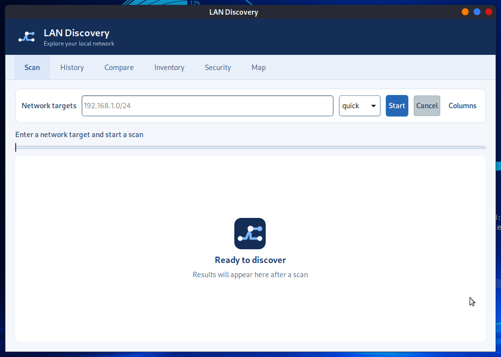
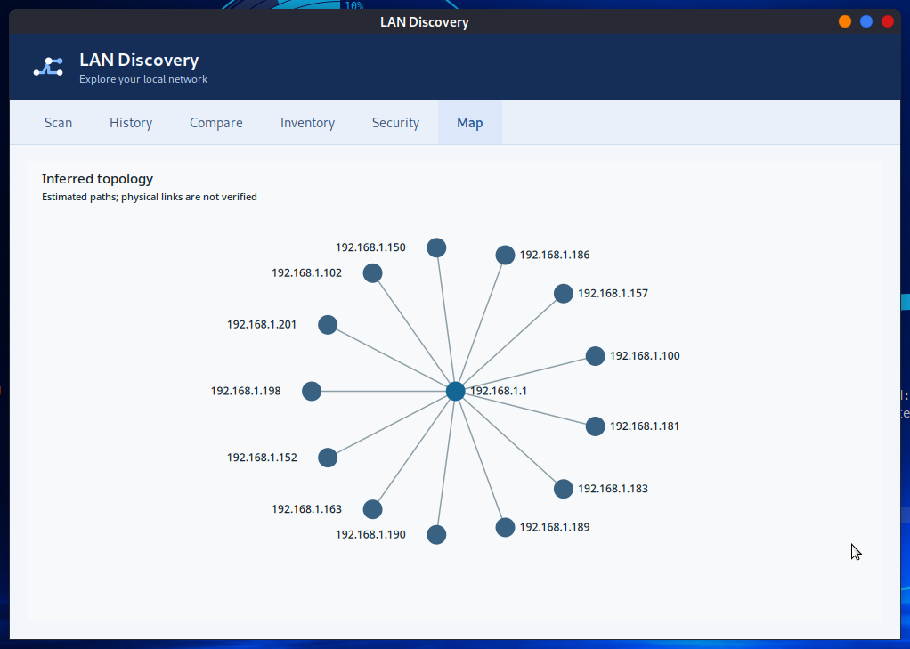

# LAN Discovery

LAN Discovery helps you understand what is reachable on a local IP network. It
collects host and service details, keeps a local history, highlights changes
between comparable scans, and draws an **inferred** network map.



## What you can do

- **Find devices:** scan an IP address or CIDR range and inspect IP, hostname,
  MAC address, vendor, latency, open ports, services and operating system hints
  when the network and selected profile provide them. IPv4 and IPv6 targets are
  supported.
- **Choose the depth:** use `ping` for host discovery, `quick` for common ports,
  `full` for ports 1–65535 with service and OS detection, or `security` for
  selected service checks. Custom profiles can enable mDNS, SSDP, SNMP and
  traceroute where the required tools and network support are available.
- **Track changes:** save scans locally, reopen them from History, and compare
  newly seen, missing or changed hosts. The app reports new and missing hosts
  only when both scans are complete and cover comparable targets with the same
  discovery method.
- **Keep an inventory:** attach a name, notes and tags to a device key so useful
  context remains available across scans.
- **Review service exposure:** the Security view presents findings from a fixed
  set of non-intrusive Nmap scripts, including service banners and selected
  Telnet, FTP, SMB, HTTP, SSH, TLS and RDP checks. Findings are observations,
  not proof that a device is vulnerable.
- **Act on a host:** right-click a result to copy its IP or open SSH, RDP, a
  browser, ping or traceroute. Wake on LAN is available when a MAC address is
  known. External clients must be installed for the corresponding actions.
- **Share results:** export a saved scan as CSV, JSON or a standalone HTML table.

## Inferred network map

The Map view places discovered hosts around the gateway and lets you zoom, pan,
move nodes and select a host to return to its result row. Lines represent an
estimate from discovery and route data. They **do not** identify physical switch
ports or prove which cables connect devices.



## Install

Install from the [SysLinuxOS-Tools APT repository](https://github.com/fconidi/SysLinuxOS-Tools)
with `sudo apt install landiscovery`, or download the
[1.0.4 Debian package](https://github.com/fconidi/landiscovery/releases/tag/v1.0.4)
and install it with `sudo apt install ./landiscovery_1.0.4_all.deb`.

The graphical application appears in the **SysLinuxOS Tools** and **Networking**
menus. Run `landiscovery gui` or `lds gui` from a terminal. The package requires
Python 3.11 or newer, GTK 3, Nmap, arp-scan and polkit. Avahi and SNMP tools
provide optional discovery features.

## Scan and review

Enter an IP address or CIDR network, choose a profile and select **Start**. A
larger or public range needs confirmation; IPv6 networks wider than `/112` are
refused. Privileged steps request authorization through polkit. Without it,
some fields may be unavailable and the result is marked as reduced. **Cancel**
stops an active scan and keeps the partial result distinct from a complete one.

Use **History** to reopen or export a scan, **Compare** to inspect changes,
**Inventory** to edit device notes, and **Security** to review findings. The
**Columns** button controls which host details are visible in the results table.

The command line offers the same core workflow:

```text
landiscovery scan 192.168.1.0/24 --profile quick
landiscovery history
landiscovery compare 1 2
landiscovery export 2 --format html -o scan.html
```

Use `--json` with `scan` for structured output. A profile using SNMP asks for
its community interactively; automation can supply one line on standard input
with `--snmp-community-stdin`. The community is not stored in scan history.
Scan history and device notes live in the user's local data directory. Results
can vary when devices are offline, filtered or change during a scan.

License: GPL-3.0-or-later.
